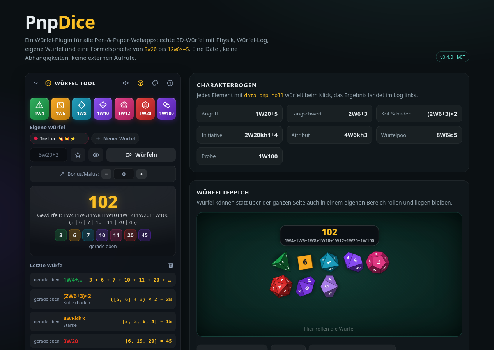
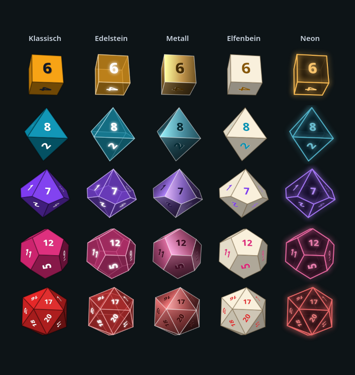

# redneckDice

[](https://github.com/DonDavis-vibe/redneckDice/actions/workflows/test.yml)
[](LICENSE)


**A dice plugin for pen & paper web tools: animated 3D dice, a roll log, custom dice, hidden GM rolls and multiplayer replays. One file, no dependencies, no network requests.**

[Live demo](https://dondavis-vibe.github.io/redneckDice/) · [Deutsche Anleitung](docs/ANLEITUNG.md) · [Changelog](CHANGELOG.md)



redneckDice drops into any tabletop RPG web app, from character sheets and GM dashboards to virtual tabletops. It runs entirely in the browser: no CDN, no web fonts, no server, no tracking. Just add one `<script>` tag.

## Features

- **Animated 3D dice:** d4, d6, d8, d10, d12, d20 and d100 (a tens and a units d10), with physics, shadows, optional synthesized dice sounds and a result badge
- **Five looks:** classic, gemstone, metal, ivory and neon, plus your own via `defineTheme()`
- **Full dice notation:** keep/drop, advantage, exploding, rerolls, success pools, Fudge dice, maths with brackets, `ceil()`/`floor()`/`min()`/`max()`
- **Reroll a single die:** click a die that has landed. The other dice stay where they are.
- **Hidden GM rolls:** other players see `?` dice and no values leave the GM's machine until they reveal the roll
- **Custom dice:** symbols, values or both, e.g. `3d{Hit}`, or inline faces like `1d[Heads,Tails]`
- **Ready-made widget:** quick dice, formula input, bonus/penalty, favourites, custom-die editor, dice look picker and an optional persistent roll log. It lives in a Shadow DOM so your app's CSS can't break it, and CSS custom properties let you theme it.
- **Multiplayer-ready:** a roll packs into under 100 bytes and replays on other clients with the same values and animation
- **Honest randomness:** results come from `crypto.getRandomValues` without modulo bias. The animation only shows the result, it never decides it.
- **Accessible:** respects `prefers-reduced-motion`, keyboard friendly, `aria-live` results, English and German UI

## Quick start

```html
<script src="pnp-dice.js"></script>
<div id="dice"></div>
<script>
  PnpDice.mount('#dice');      // the full dice widget
  PnpDice.bindAttributes();    // every [data-pnp-roll] element rolls on click
</script>

<button data-pnp-roll="1d20+5" data-pnp-label="Attack">Attack</button>
```

> The library is exposed as the global `PnpDice` (file `pnp-dice.js`). redneckDice is the project name.

As an ES module, which also works with Vite and other bundlers:

```js
import PnpDice, { roll, mount } from './pnp-dice.mjs';
```

To run the demo locally:

```bash
git clone https://github.com/DonDavis-vibe/redneckDice.git
cd redneckDice
npm run dev        # or: python3 -m http.server 8777
```

Then open http://localhost:8777.

## Rolling without the widget

```js
const r = await PnpDice.roll('3d20+2', { label: 'Check' });   // 3D dice over the page
r.total      // 47
r.detail     // "[6, 19, 20] + 2 = 47"
r.text       // "Check – 3d20+2: [6, 19, 20] + 2 = 47"
r.crit       // true if every die shows its maximum (the rule can be changed)

PnpDice.evaluate('4d6kh3');                   // evaluate only: synchronous, no animation
PnpDice.roll('2d6', { tray: '#mat' });        // roll inside an element instead of over the page
PnpDice.roll('1d20', { animate: false });     // no animation
```

`roll()` returns a promise that resolves once the dice have landed. If the formula is invalid, the promise rejects with a `PnpDiceError` whose message is in the configured language.

## Dice notation

`d` and the German `w` work the same, so `3d20` equals `3w20`.

| Notation | Meaning |
|---|---|
| `3d20` | three d20, summed |
| `2d6+3`, `1d20-1d4` | add or subtract numbers and other dice |
| `4d6kh3` / `4d6kl1` | keep the highest / lowest n |
| `4d6dl1` / `4d6dh1` | drop the lowest / highest n |
| `2d20kh1` / `2d20kl1` | advantage / disadvantage |
| `3d6!` | exploding: a maximum rolls again |
| `1d20r1`, `2d6r<3` | reroll once if the value matches |
| `12d6>=5` | count successes (`>=`, `>`, `<=`, `<`, `=`) |
| `4dF` | Fudge / FATE dice |
| `1d%` | same as `1d100` |
| `2d{Hit}` | a registered custom die |
| `1d[Heads,Tails]` | inline faces |
| `(2d6+3)*2`, `2×(1d8+1)` | maths with `*` `×` `/` `÷` `:` and brackets, multiplication before addition |
| `ceil(1d6/2)` | functions: `floor`, `ceil`, `round`, `abs`, `min(a, b, …)`, `max(a, b, …)` (German aliases `abrunden`, `aufrunden`, `runden`, `betrag`) |
| `max(1d20,1d20)+3` | the higher of two rolls, plus 3 |
| `1d20+5 # Attack` | a label after `#` |

Division is exact, and the final result is rounded down (`7/2` is 3, `-7/2` is -4). Use `ceil()` or `round()` for other rounding. Dividing by a 0 that comes from dice gives 0, and a literal `x/0` is an error.

Limits: 1 to 100 dice per group, 1 to 10000 sides, at most 20 dice groups and numbers per formula. Dice with other side counts (d3, d7, d30, …) roll as the closest polyhedron and still land on the correct value.

## Custom dice

```js
// Symbols with values: the values are summed
PnpDice.defineDie('Hit', {
  faces: ['💥', '💥', '⭐', '–', '–', '–'],
  values: [1, 1, 2, 0, 0, 0],
  color: '#e11d48',
});

// Symbols only: results are counted ("2× Sun · 1× Moon")
PnpDice.defineDie('Omen', ['Sun', 'Moon', 'Star']);

// Force a body
PnpDice.defineDie('Direction', { faces: ['N', 'E', 'S', 'W'], shape: 'd4' });
```

Players can also create their own dice in the widget with "New die". They are stored in `localStorage`.

## The widget

```js
const widget = PnpDice.mount('#dice', {
  title: 'GM dice box',
  quick: ['1d6', '1d100'],      // quick dice; also { notation, label, color }
  log: true,                    // show the roll log
  logLimit: 25,
  customDice: true,             // "Custom dice" section
  favorites: true,              // the star saves the current formula as a quick die
  modifier: true,               // bonus/penalty field, reset after each roll …
  modifierSticky: false,        // … unless this is true
  reroll: true,                 // dice bar under the result for single rerolls
  hiddenRolls: true,            // eye toggle for hidden rolls
  looks: true, theme: null,     // dice look picker / fixed look
  input: true, help: true, collapsible: true, collapsed: false,
  storageKey: 'pnp-dice',       // false = store nothing; pick one key per app
  captureAll: true,             // also show rolls made elsewhere (roll, data-pnp-roll, replay)
  tray: undefined,              // dice surface just for this widget
  sound: false, animate: true,  // initial values; players toggle them in the header
  lang: 'en',
  onRoll: r => postToDiscord(r.text),
});

widget.roll('2d10');
widget.on('settle', r => { /* … */ });
widget.rerollDie(0, 2);         // reroll the third die of the first group of the last roll
widget.setHidden(true);         // hidden rolls on
widget.setTheme('neon');
widget.getLog(); widget.clearLog(); widget.setCollapsed(true); widget.destroy();
```

Also available: `modifier: false` together with `modifierProvider: () => 3` takes the bonus from a field in your app, and `display: false` hides the big result display when your app shows the result itself.

Controls: click a die to roll it. Shift-click or right-click adds it to the formula (`2d6+1d20`). Arrow ↑ in the input recalls the last formula, and Esc clears the dice.

### Styling

The widget inherits your page's font. Colours can be set on the host element or any ancestor:

```css
#dice {
  --pd-accent: #fbbf24;           /* big number, log values */
  --pd-bg: rgba(14, 34, 30, .9);
  --pd-border: rgba(94, 234, 212, .22);
  --pd-surface: rgba(255,255,255,.045);
  --pd-surface-2: rgba(255,255,255,.085);
  --pd-text: #e8ecf1;
  --pd-muted: #94a3b8;
  --pd-success: #4ade80;
  --pd-danger: #f87171;
  --pd-radius: 14px;
  --pd-font: inherit;
  --pd-log-height: 300px;
}
```

You can also target `::part(panel|header|body|quick|display|log)`.

## Global settings

```js
PnpDice.configure({
  lang: 'auto',            // 'de' | 'en' | 'auto'; add languages via PnpDice.i18n.xx = {…}
  animate: 'auto',         // true | false | 'auto' (with prefers-reduced-motion the dice appear at rest)
  sound: false, volume: 0.6,
  tray: 'overlay',         // 'overlay' | Element | '#selector' | false
  holdMs: null,            // how long dice stay; null = 2.6 s for the overlay, forever in a container
  theme: 'classic',        // dice look, see below
  dieSize: 38,             // largest die radius in px
  maxDice: 30,             // more dice are evaluated but not drawn
  showTotal: true,         // result badge above the dice
  rerollClick: true,       // click a die that has landed to reroll it
  hiddenAnimation: 'open', // hidden rolls: 'open' (you see the values) | 'masked' (you also see "?", e.g. on a projector)
  colors: { 6: '#f59e0b', 20: '#dc2626', custom: '#0d9488' },
  crit: null,              // your own critical/fumble rule, see below
  rng: null,               // your own RNG, e.g. PnpDice.createRng('seed')
});
```

### Criticals and fumbles

By default, a roll with a single dice group is a critical when every die shows its maximum and a fumble when every die shows 1. Other systems can bring their own rule:

```js
// "How to be a Hero": a 1 on the d100 is a critical, 100 a fumble
PnpDice.configure({
  crit: r => {
    const g = r.groups[0];
    if (!g || g.sides !== 100) return null;
    const v = g.rolls[0].value;
    return v === 1 ? 'crit' : v === 100 ? 'fumble' : null;
  },
});
```

## Dice looks



| Name | Look |
|---|---|
| `classic` | coloured plastic, white numbers |
| `gem` | translucent gemstone with visible back edges and a tinted shadow |
| `metal` | polished metal in the die colour, engraved numbers |
| `ivory` | ivory body, numbers in the die colour |
| `neon` | dark body, glowing edges and numbers, a light spot instead of a shadow |

```js
PnpDice.configure({ theme: 'metal' });          // all rolls
PnpDice.roll('1d20', { theme: 'neon' });        // this roll only
PnpDice.mount('#dice', { theme: 'gem' });       // fixed for this widget, no player choice …
PnpDice.mount('#dice', { looks: false });       // … or hide the picker
```

In the widget, the palette button opens the look picker with live previews. The choice is saved, and unless the app passes a fixed `theme`, it applies to every roll on the page.

Build your own look from these parts. Colours can be `'die'` (the die colour), a hex value or a function `(dieRgb, bodyRgb) => [r, g, b]`:

```js
PnpDice.defineTheme('blood', {
  label: { de: 'Blutstein', en: 'Bloodstone' },
  body: '#3b0a0a',
  ink: '#fca5a5',           // numbers; 'auto' picks light or dark to match the body
  opacity: 1,               // < 1 = translucent
  ambient: 0.46, diffuse: 0.6, specular: 0.6, shininess: 40,
  metallic: 0,              // 0..1 metal gradient across each face
  edge: 'rgba(252,165,165,.6)', edgeWidth: 0.04, edgeGlow: 0.2,
  inkStyle: 'glow',         // 'emboss' | 'engrave' | 'glow' | 'flat'
  floor: 'tint',            // 'shadow' | 'tint' | 'glow'
});

PnpDice.listThemes();                                                              // [{ name, label }, …]
PnpDice.renderPreview(canvas, { theme: 'blood', shape: 'd20', color: '#dc2626', value: 20 });   // preview image
```

## Rerolling a single die

Once the dice have landed, every die can be clicked: luck points, Edge, inspiration. Only that die rolls again while the others stay exactly where they are. The total, keep/drop, successes and criticals are recalculated. The overlay never blocks your page, because it only accepts clicks directly over a die, and the dice stay visible while the mouse is over one. In the widget, the dice bar under the result does the same.

```js
const r = await PnpDice.roll('4d6kh3');
const next = await PnpDice.reroll(r, 0, 2);   // group 0, die 2: animated, the others stay put
PnpDice.rerollDie(r, 0, 2);                    // same without animation
PnpDice.applyReroll(r, 0, 2, 6);               // set a die to a fixed value
next.id === r.id;    // true: same roll, so the log replaces the entry
next.rerolls;        // [[0, 2, 6]]; the old value is in next.groups[0].rolls[2].manual
```

A reroll fires `roll` and `settle` like a normal roll. Rerolled dice do not explode again.

## Hidden GM rolls

```js
const r = await PnpDice.roll('1d20+5 # Perception', { hidden: true });
PnpDice.replayData(r);   // { n: '1d20+5', h: 1, i: '…', l: 'Perception' }: no values!
PnpDice.reveal(r);       // fires 'reveal'; replayData now carries the real values under the same id
```

The GM sees their roll as usual, marked as hidden and with a "Reveal" button. In the log the value stays blurred until hovered, which helps on a shared screen. Players who receive the roll via `replay()` see `?` dice and "rolled in secret". After the reveal, the real roll replaces that log entry. With `hiddenAnimation: 'masked'` the GM's own dice show `?` too. In the widget, the eye next to "Roll" toggles hidden rolls.

## Events and multiplayer

```js
PnpDice.on('roll', r => { /* … */ });     // immediately, the dice are still rolling
PnpDice.on('settle', r => { /* … */ });   // the dice have landed and the result is shown
PnpDice.on('reveal', r => { /* … */ });   // a hidden roll was revealed
PnpDice.on('dice', list => { /* … */ });  // custom dice were added or removed
```

Sending a whole result object works (`PnpDice.show(result)` animates it on the receiving side), but `replayData` is much smaller. It sends only the formula and the raw random values, and the receiver rebuilds the roll through the regular parser with all of its limits and validation:

```js
// sender
PnpDice.on('roll', r => { const d = PnpDice.replayData(r); if (d && !r.remote) socket.send(JSON.stringify(d)); });
PnpDice.on('reveal', r => socket.send(JSON.stringify(PnpDice.replayData(r))));

// receiver: same values, same animation, log entry; rejects with PnpDiceError on bad data
socket.onmessage = e => PnpDice.replay(JSON.parse(e.data)).catch(() => {});
```

The data also carries the roll id (`i`), single-die rerolls (`x`) and, for hidden rolls, only `h: 1` instead of values. `replayData` returns `null` for rolls with custom dice (the receiver doesn't know them) and for oversized rolls. `PnpDice.replayResult(data)` rebuilds the result without animation.

A result contains `id`, `notation`, `label`, `total`, `display`, `unit`, `detail`, `text`, `groups` (every single die), `modifier`, `successes`, `tally`, `min`, `max`, `crit`, `fumble`, `raw`, `timestamp`, and when applicable `hidden`, `remote` and `rerolls`. In `detail` and `text`, dropped dice are marked as `~~5~~`, which Discord renders as strikethrough.

### Showing results your app already rolled

If your app has already rolled (a check, damage …), `fixedRng` makes the 3D dice land on exactly those values:

```js
PnpDice.roll('1d100', { rng: PnpDice.fixedRng([37]), label: 'Check' });
PnpDice.roll('5d10',  { rng: PnpDice.fixedRng([7, 3, 9, 1, 4]) });
```

## How the animation works

The result always comes from the engine first. Then the whole throw is simulated in advance: gravity, bounces, collisions, rolling and settling. Once it's known which face ends up on top, the numbers are placed on the body so that exactly the rolled value lands there, and opposite faces still add up to N+1 like on real dice. Rendering uses a 2D canvas with its own perspective projection, per-look shading and highlights. No WebGL and no 3D library are needed.

## Browser support

All current evergreen browsers (Chrome/Edge 111+, Firefox 113+, Safari 16.2+). The engine (`parse`, `evaluate`, `replayResult`, …) also runs in Node.js 20+.

## Development

```bash
npm test                    # unit tests (node:test, no dependencies)
scripts/screenshots.sh      # regenerates the images in docs/ with headless Firefox
```

The tests cover the parser, maths, evaluation, rerolls, hidden rolls, network data, RNG distribution and the polyhedra. They also simulate 150 throws and check that every die lands with the rolled value on top. GitHub Actions runs them on every push with Node 20, 22 and 24.

The demo (`index.html`) has two presentation modes used for the screenshots: `#showcase` and `#looks`.

## License

[MIT](LICENSE) © 2026 Don Davis
